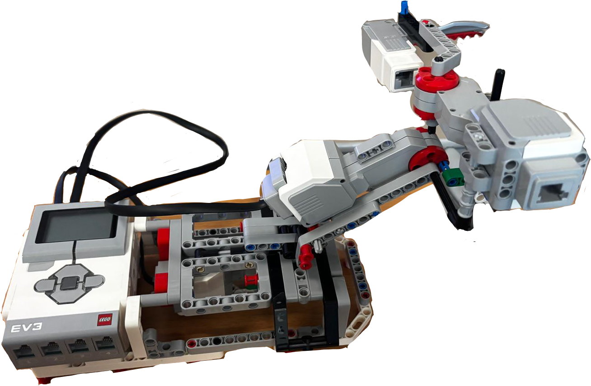
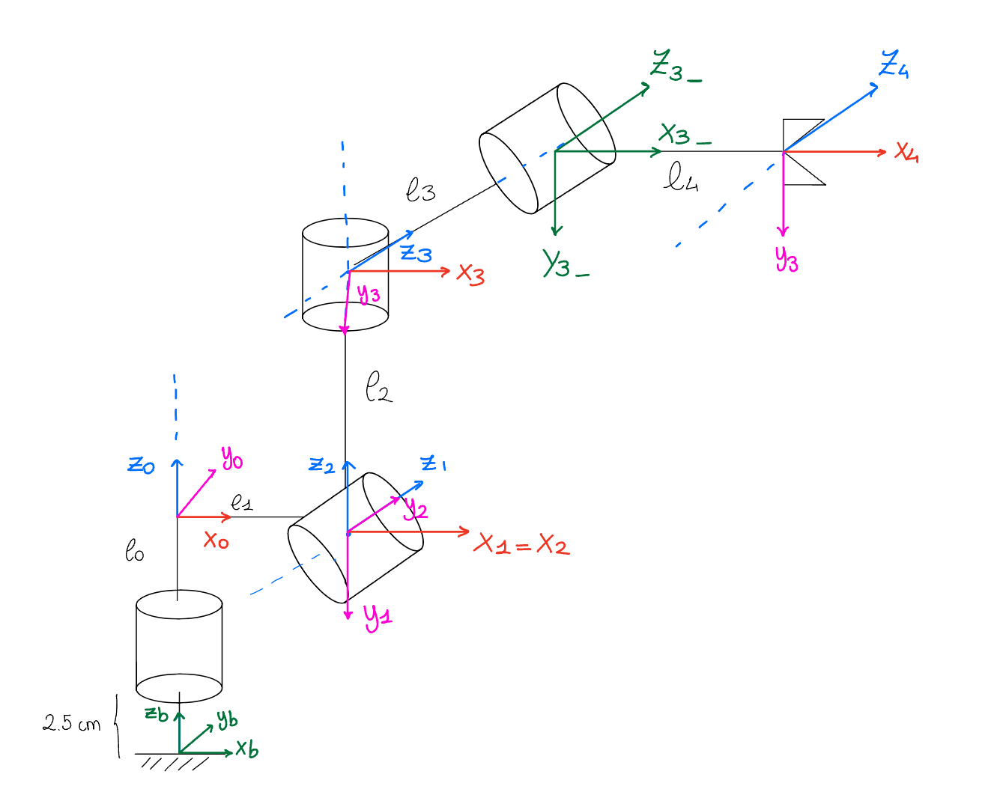
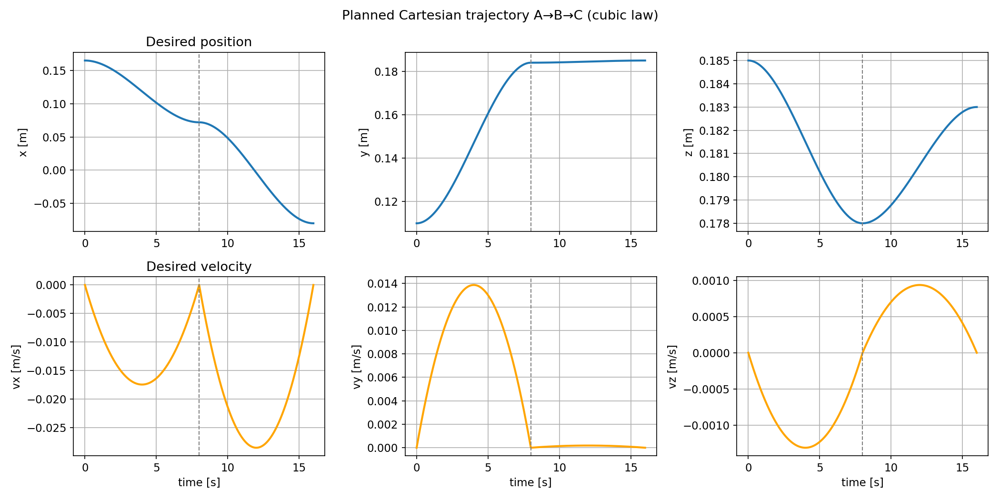
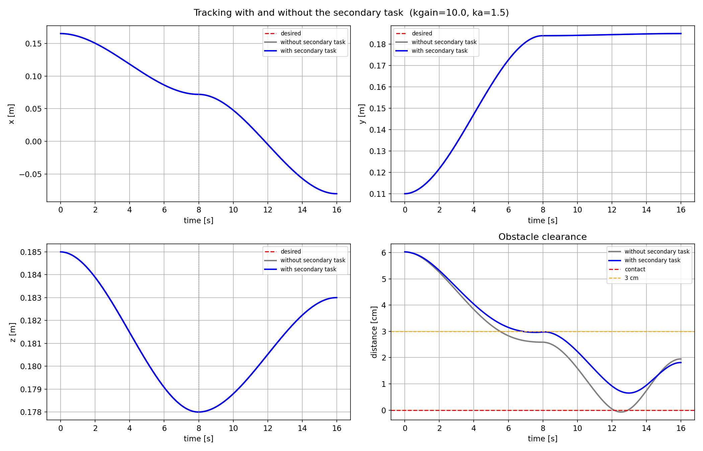
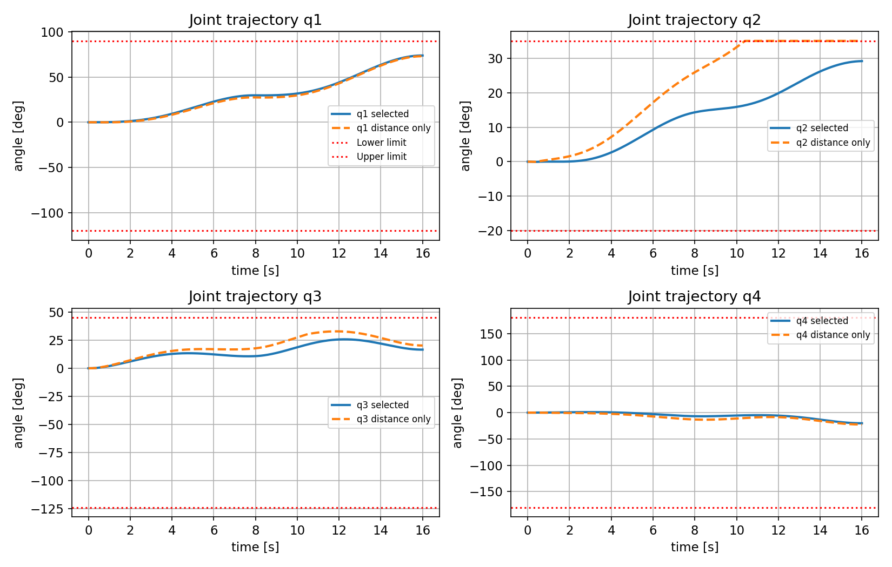
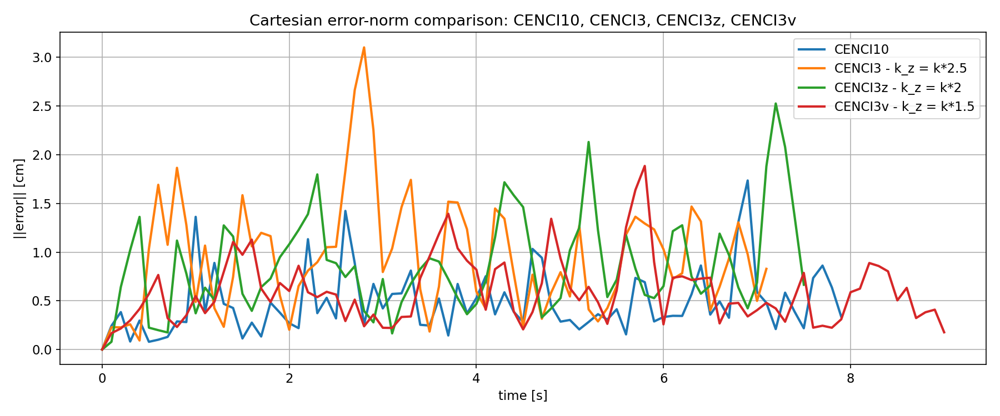
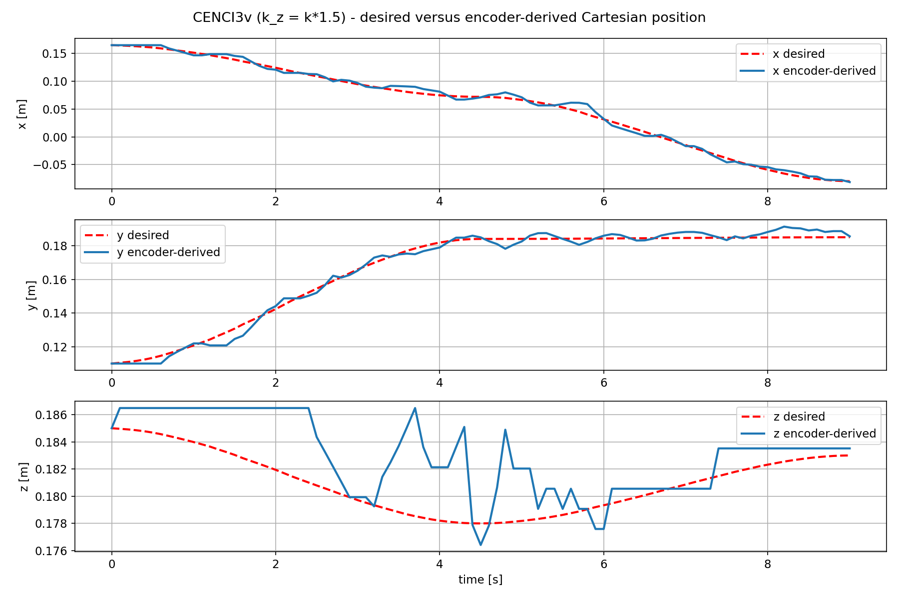

# Four-DOF LEGO EV3 Robotic Manipulator

Kinematic modelling, Cartesian trajectory tracking and redundancy resolution for a four-joint LEGO EV3 arm, developed for a Biomedical Robotics university project. The work combines a hardware-free simulation with encoder-feedback control and analysis of trials on the physical robot.

**Scope:** null-space obstacle avoidance is implemented in simulation. The physical controller implements Cartesian closed-loop inverse kinematics without the obstacle-avoidance task. Simulation accuracy must not be interpreted as measured physical accuracy.

## Physical robot

Project photograph extracted directly from slide 4 of the original presentation. Four revolute joints provide one redundant degree of freedom for a three-dimensional position task when the Jacobian has full row rank. EV3 large motors connect to ports A, B and C; a medium motor connects to D. Encoder feedback provides the joint angles used by the controller.

Joint 1 uses the implemented **12/36 transmission ratio**: its angle is one third of motor-1 encoder rotation, while motor targets are multiplied by three. Motor 1 receives three times the nominal motor speed setting. The original comment saying 32 teeth disagreed with both the implemented ratio and slide 11; the documented ratio follows the code and slide. Confirm the physical gearing before operation.

## Kinematic model

Original project frame drawing from slide 4. The chain uses standard Denavit–Hartenberg transforms, a base-height translation and a fixed auxiliary transform between joints 3 and 4. The auxiliary transform is not a fifth degree of freedom.

| Transform | a (m) | d (m) | alpha | theta |
|---|---:|---:|---|---|
| Base | 0 | 0.140 | 0 | 0 |
| Joint 1 | 0.080 | 0 | −π/2 | q1 |
| Joint 2 | 0 | 0 | +π/2 | q2 |
| Joint 3 | 0 | 0.045 | −π/2 | q3 |
| Fixed auxiliary link | 0 | 0.110 | 0 | 0 |
| Joint 4 | 0.085 | 0 | 0 | q4 |

Forward kinematics returns every link frame and endpoint. The linear Jacobian is 3×4, with each revolute-joint column calculated as `z × (p_end − origin)`. Joint limits in degrees are **[−120, 90]**, **[−20, 35]**, **[−124, 45]** and **[−180, 180]**. Positions use metres and internal joint calculations use radians.

## Cartesian trajectory planning

The end effector follows two straight Cartesian segments:

| Waypoint | x (m) | y (m) | z (m) |
|---|---:|---:|---:|
| A | 0.165 | 0.110 | 0.185 |
| B | 0.072 | 0.184 | 0.178 |
| C | −0.080 | 0.185 | 0.183 |

A coincides with the end-effector position at zero joint angles. The nearly constant height reduces demand on the restricted second-joint range. Each segment uses a cubic scalar displacement with zero endpoint velocity, producing position and velocity continuity at B; acceleration continuity is not imposed. Simulation uses 8 s per segment and a 0.02 s integration step. The supplied hardware script uses 12 s per segment.

Regenerated from the original simulation equations with translated labels; these are simulation profiles, not hardware measurements.

## Closed-loop inverse kinematics and redundancy

The primary position task uses

$$\dot q = J^+(\dot x_d + K(x_d-x)).$$

The simulation adds a secondary term:

$$\dot q = J^+(\dot x_d+Ke)+(I-J^+J)\,k_a\nabla_q d(q)\,\mathbf{1}_{d<d_{act}}.$$

The obstacle is a sphere centred at **[−0.005, 0.062, 0.183] m**, radius **0.025 m**. The objective increases the signed clearance of the fixed auxiliary link's midpoint from the sphere. Its gradient is `J_mid.T @ unit_direction`, independently derived with SymPy. The task activates below **0.06 m** local clearance.

A separate diagnostic evaluates minimum sphere-to-segment clearance over the entire chain. It does not change the objective into a global-distance controller. The link model uses line segments, not complete physical link volumes. Null-space separation holds instantaneously before clipping; finite integration steps and saturation can perturb tracking.

Regenerated simulation comparison using the original gain selection and algorithm.

## Gain tuning and simulation results

The original search first evaluates primary gains with `ka=0` and checks mean error ≤0.35 mm and maximum error ≤0.60 mm. The implemented ranking prefers qualifying gains ≤10 and then lower mean error; it does **not** simply choose the smallest qualifying gain as stated in the presentation. Secondary-gain selection seeks the largest minimum local clearance subject to clearance ≥0.6 cm and joint margin ≥2°, with the original fallback rules preserved.

| Historical simulation metric | No secondary task | Selected ka=1.5 | Aggressive ka=3 |
|---|---:|---:|---:|
| Primary gain | 10 | 10 | 10 |
| Minimum local clearance (cm) | −0.074 | 0.649 | 1.172 |
| Mean logged tracking error (mm) | 0.007 | 0.007 | 0.237 |
| Maximum logged tracking error (mm) | 0.014 | 0.014 | 0.833 |
| Maximum q2 (degrees) | 11.45 | 29.16 | 35.00 |
| Minimum joint margin (degrees) | Not tabulated here | 5.84 | 0.00 |

Saved global centreline clearance changes from **−0.137 cm** to **+0.636 cm** for the selected controller. Analytic and symbolic gradient simulations agree to numerical precision in the original outputs. The aggressive trial reaches the q2 limit for 281 samples, demonstrating the clearance–tracking–joint-margin tradeoff.

The original logged error compares the current desired position with the previous-step joint configuration, before its integration update. This convention is preserved and explains why the values should not be silently substituted for post-update tracking errors. Negative signed clearance denotes penetration in the geometric simulation model.

Original simulation calculations rerun with English labels; the aggressive configuration saturates joint 2.

## Physical controller

[robot_control/main.py](robot_control/main.py) remains a standalone Python script. Device access occurs only inside `main()`; importing the module does not instantiate motors or run the controller.

Each cycle reads encoder positions, compensates joint-1 gearing, converts angles to radians, reconstructs Cartesian position and evaluates the online cubic planner. It then calculates a pseudoinverse joint-velocity command using **K=diag(3,3,4.5)**, clips joint speed to **15°/s**, measures and clips the integration interval to **[0.0001, 0.10] s**, and computes a target from `q_real + dt*qdot`. Joint increments are additionally limited to **3°**, and position targets are clipped to joint limits. Targets are converted to motor degrees and sent using non-blocking `on_to_position` calls. The loop includes a 0.01 s sleep.

The controller logs desired/encoder-derived Cartesian positions, commanded/encoder joint positions, joint velocities and clipped integration intervals. Encoder resetting establishes software zero; it is not an automatic homing routine. Physical alignment must be checked before a run. There is no implemented hardware obstacle avoidance or dynamic gravity compensation.

## Experimental validation

The original saved analysis reports the following Euclidean Cartesian errors, reconstructed from encoder readings:

| Trial | Historical vertical-gain annotation | Mean error (cm) | Maximum (cm) | Final (cm) |
|---|---|---:|---:|---:|
| CENCI10 | K=10; exact vertical factor not verified from a supplied variant | 0.482 | 1.736 | 0.337 |
| CENCI3v | k=3, kz=1.5k | 0.597 | 1.885 | 0.177 |
| CENCI3z | kz=2k | 0.862 | 2.526 | 0.665 |
| CENCI3 | kz=2.5k | 0.950 | 3.102 | 0.828 |

Only the CENCI3v gain law is directly verified in the supplied physical-controller script. The remaining annotations come from the analysis notebook and presentation rather than archived controller variants.

Regenerated from original local logs, using the same Cartesian-error calculation. The plotted time is reconstructed from clipped integration intervals and can underestimate elapsed wall-clock time; it is not a verified timestamp trace.

The Z component shows greater tracking difficulty than X/Y in this trial. Gravity, friction, mechanical backlash and EV3 motor response are plausible contributors discussed in the original presentation, not separately identified experimental causes.

The presentation favours CENCI3v as a smoother compromise despite CENCI10's lower mean Cartesian error. Original joint plots incorrectly labelled radian log values as degrees; the released analysis converts them once to degrees. Qualitative oscillation comparisons remain descriptive, not a formal stability or robustness proof.

## How to run

For simulation and analysis, create a local Python environment and install `pip install -r requirements.txt`, then launch `jupyter lab`. The dependencies are proposed compatible ranges, not a recovered exact original environment. Run [the simulation notebook](simulation/Robot_Kinematics_and_Obstacle_Avoidance.ipynb) in cell order without EV3 hardware. Workspace sampling and the full gain search can take time; interactive sliders require a suitable Matplotlib backend.

For [experimental analysis](experimental_analysis/Real_Robot_Experimental_Results.ipynb), set `EV3_LOG_DIR` to the original log directory. Logs are not included in the public repository. The loader expects whitespace-separated numeric files with a shared trial prefix:

| Suffix | Columns | Unit |
|---|---:|---|
| `_Pd_xyz_online.txt` | 3 | m |
| `_Preal_xyz_online.txt` | 3 | m |
| `_Qdes_online.txt` | 4 | rad |
| `_Qreal_online.txt` | 4 | rad |
| `_dt_reale_online.txt` | 1 | s, clipped integration interval |
| `_Qdot_online.txt` (optional) | 4 | rad/s |

Legacy suffixes are supported by the loader. A timing file is required to avoid labelling sample indices as seconds. Arrays are aligned to the shortest available length, preserving the original convention.

**Hardware execution is separate:** install the EV3-specific packages in [robot_control/requirements-ev3.txt](robot_control/requirements-ev3.txt) on a compatible ev3dev system, verify motor ports, polarity, gearing, software-zero alignment and joint limits, and run the script on the robot only under direct supervision. The code was not run on connected hardware during repository preparation. Cleanup now attempts to brake every constructed motor in `finally`, including on unexpected errors; this change requires verification on the actual robot and is not a safety certification.

## Repository structure and validation

- `simulation/`: complete translated kinematics, symbolic verification, tuning and simulation notebook.
- `robot_control/`: import-safe physical controller and separate hardware dependencies.
- `experimental_analysis/`: translated log-loading and physical-trial analysis notebook.
- `assets/`: project photo, frame drawing, regenerated simulation and experimental plots.
- `docs/`: methodology, source provenance and validation results.

See [METHODOLOGY.md](docs/METHODOLOGY.md) for technical caveats and changes, and [VALIDATION.md](docs/VALIDATION.md) for checks actually performed. Original input files are unchanged; no licence has been added. The full presentation and raw logs are not redistributed.

The project demonstrates the distinction between ideal kinematic redundancy resolution and the constraints encountered in encoder-feedback execution on a physical LEGO manipulator. Results from a single geometry and a small set of trials do not establish general collision-avoidance guarantees, dynamic stability or clinical applicability.
